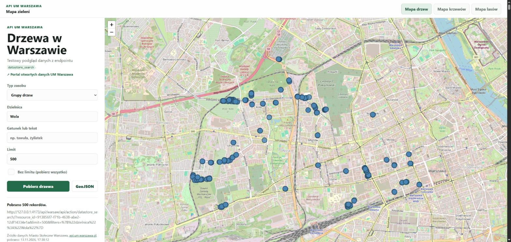

# Warsaw Tree API Map

> **PL:** Mapa i tabela drzew, krzewów i lasów z otwartego API Urzędu m.st. Warszawy. To prototyp pobierania danych o drzewach, który zrobiłem w maju 2026 na potrzeby Hydroplanu.

A React app that pulls tree, shrub and forest data from the City of Warsaw open data API and shows it on a Leaflet map and in a table. You pick a dataset, optionally narrow it down by district or search text, and the app fetches the matching records. The interface is in Polish.



Demo: DEMO_URL

## Data

The data comes from the City of Warsaw open data portal ("otwarte dane po warszawsku", http://api.um.warszawa.pl) through its CKAN `datastore_search` endpoint. The app uses four resources:

| Resource | Resource ID | Records (Nov 2026) |
| --- | --- | --- |
| Trees (Drzewa) | `ed6217dd-c8d0-4f7b-8bed-3b7eb81a95ba` | 139,348 |
| Tree groups (Grupy drzew) | `913856f7-f71b-4638-abe2-12df14334e1a` | 29,202 |
| Shrubs (Krzewy) | `0b1af81f-247d-4266-9823-693858ad5b5d` | 22,123 |
| Forests (Lasy) | `75bedfd5-6c83-426b-9ae5-f03651857a48` | 63,286 |

`scripts/verify_ids.py` checks that all four IDs still respond and prints their field names. It only needs the Python standard library.

These datasets don't have a named licence. The portal allows free use under the Polish Act of 25 February 2016 on the re-use of public sector information, as long as you credit "Miasto Stołeczne Warszawa" and give the dates the data was created and obtained. The app shows the source and the date it fetched the data below the status line.

## What the app does

- Three views: trees (single trees or tree groups), shrubs and forests. Forests get their own table columns and popup, since the forest records describe forest subdivisions, not individual plants.
- District filter. It's sent to the API as `filters={"dzielnica": ...}`, so the name has to match exactly, e.g. "Wola".
- Text search through the API's `q` parameter, e.g. a species name like "żylistek".
- A record limit, or a "Bez limitu" mode that fetches every matching record page by page (100,000 per request) and shows progress in the status line.
- GeoJSON export of the loaded records that have coordinates. Each feature keeps the original API record under `properties.source`.
- Field normalization in `src/normalize.js`. The resources don't name their fields consistently (the Latin species name is `gatunek_1` for trees and `gatunek1` for shrubs, and the forest data has `obwód` with a Polish character), so I map them to one shape and fill missing values with "-".

## Tech stack

React 18, Vite 6, Leaflet 1.9 and react-leaflet 4. There's no backend.

## Running locally

```bash
npm install
npm run dev
```

The dev server runs on http://127.0.0.1:5173.

Requests go through `/api/warsaw`, proxied by Vite locally (`vite.config.js`) and by `vercel.json` on Vercel.

## Limitations

In "Bez limitu" mode every record becomes a separate map marker, and the trees resource alone has about 139,000 records, which can make the browser slow or unresponsive. Marker clustering or loading only the visible map area would fix that, but neither is implemented.

## Background: Hydroplan

I built this in May 2026 as a quick prototype for fetching tree data for Hydroplan (https://hydroplan-chi.vercel.app/), an app deployed for Fundacja Alter Eko. I co-developed Hydroplan as part of a team. In November 2026 I cleaned it up for my portfolio (README, deployment, splitting up the main component), but it's still a prototype, not a finished product.

## License

The code is MIT licensed, see [LICENSE](LICENSE). The data follows the portal's terms described in [Data](#data).
